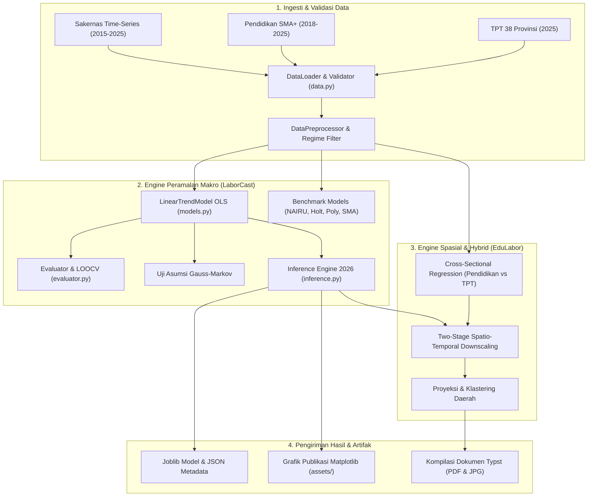

# 📊 LaborCast & EduLabor: Sistem Peramalan Tingkat Pengangguran Terbuka (TPT) dan Analisis Spasio-Temporal Pendidikan Indonesia

[](https://www.python.org/)
[](https://scikit-learn.org/)
[](https://docs.pytest.org/)
[](https://astral.sh/ruff)
[](https://typst.app/)
[](#-tim-peneliti--pengembang)

> **Proyek Akhir:** Penilaian Sumatif Akhir Jenjang (PSAJ) Matematika Terintegrasi Kejuruan PPLG  
> **Institusi:** SMK Telkom Purwokerto — Tahun Ajaran 2026/2027  
> **Metode Utama:** *Simple Linear Regression* berbasis *Ordinary Least Squares* (OLS), Evaluasi 5 Model Benchmark, dan *Spatio-Temporal Hybrid Downscaling*  
> **Dataset Acuan:** Badan Pusat Statistik (BPS) RI — Sakernas (2015–2025) & Survei Demografi Pendidikan (2018–2025)  
> **Target Proyeksi:** Horizon Satu Tahun ke Depan (**Tahun 2026**) & Pemetaan Disparitas 38 Provinsi serta 514 Kabupaten/Kota

---

## 📌 Daftar Isi

1. [Tentang Proyek & Latar Belakang](#-tentang-proyek--latar-belakang)
2. [Katalog Lengkap Dataset Empiris](#-katalog-lengkap-dataset-empiris)
   * [1. Dataset Deret Waktu TPT Nasional (2015–2025)](#1-dataset-deret-waktu-tpt-nasional-20152025)
   * [2. Dataset Spasial TPT 38 Provinsi (2025)](#2-dataset-spasial-tpt-38-provinsi-2025)
   * [3. Dataset Pendidikan SMA ke Atas (2018–2025)](#3-dataset-pendidikan-sma-ke-atas-20182025)
   * [4. Berkas Konsolidasi & Data Gabungan Turunan](#4-berkas-konsolidasi--data-gabungan-turunan)
3. [Cara Kerja Sistem & Metodologi Pemodelan](#-cara-kerja-sistem--metodologi-pemodelan)
   * [A. Engine Peramalan Makro Deret Waktu (LaborCast)](#a-engine-peramalan-makro-deret-waktu-laborcast)
   * [B. Mekanisme Penggabungan 2 Semester (Februari & Agustus)](#b-mekanisme-penggabungan-2-semester-februari--agustus)
   * [C. Engine Spasial & Pemodelan Hybrid (EduLabor)](#c-engine-spasial--pemodelan-hybrid-edulabor)
   * [D. Uji Asumsi Klasik Ekonometrika Gauss-Markov](#d-uji-asumsi-klasik-ekonometrika-gauss-markov)
4. [Hasil Utama & Temuan Kuantitatif](#-hasil-utama--temuan-kuantitatif)
   * [1. Integrasi Dinamika TPT Historis (2015–2025) & Proyeksi 2026](#1-integrasi-dinamika-tpt-historis-20152025--proyeksi-2026)
   * [2. Runtun Waktu Tahunan Gabungan Pendidikan SMA+ vs TPT (2018–2025)](#2-runtun-waktu-tahunan-gabungan-pendidikan-sma-vs-tpt-20182025)
   * [3. Konsolidasi Spasial 38 Provinsi & Koridor Regional (2025)](#3-konsolidasi-spasial-38-provinsi--koridor-regional-2025)
   * [4. Analisis Wilayah Lokal: Kabupaten Banyumas](#4-analisis-wilayah-lokal-kabupaten-banyumas)
5. [Katalog Semua Kegiatan Proyek](#-katalog-semua-kegiatan-proyek)
6. [Struktur Direktori Repositori](#-struktur-direktori-repositori)
7. [Panduan Instalasi & Persiapan Lingkungan](#-panduan-instalasi--persiapan-lingkungan)
8. [Panduan Penggunaan (How to Run)](#-panduan-penggunaan-how-to-run)
9. [Relevansi Vokasi & Rekomendasi Kebijakan](#-relevansi-vokasi--rekomendasi-kebijakan)
10. [Tim Peneliti & Pengembang](#-tim-peneliti--pengembang)
11. [Daftar Pustaka](#-daftar-pustaka)

---

## 💡 Tentang Proyek & Latar Belakang

**LaborCast** adalah sistem peramalan dan analisis makroekonomi ketenagakerjaan yang mengintegrasikan kompetensi **Matematika Terapan** (statistika deskriptif, persamaan garis lurus, korelasi Pearson, estimasi kuadrat terkecil OLS, serta evaluasi galat) dengan rekayasa perangkat lunak **Pengembangan Perangkat Lunak dan Gim (PPLG)**.

Proyek ini dibangun untuk menjawab pertanyaan strategis nasional:
> *"Berapa perkiraan Tingkat Pengangguran Terbuka (TPT) nasional Indonesia pada siklus tahunan target 2026 pascapemulihan pandemi COVID-19, dan bagaimana dinamika capaian pendidikan menengah ke atas (SMA/SMK+) mempengaruhi variasi pasar kerja antardaerah?"*

### Paradigma Pemodelan:
1. **Dimensi Waktu (*Time-Series Forecasting* - LaborCast):** Memodelkan tren penurunan TPT nasional pascapandemi (2020–2025) untuk memproyeksikan angka pengangguran tahun 2026 menggunakan estimator deterministik OLS.
2. **Dimensi Spasial (*Cross-Sectional Regional* - EduLabor):** Menganalisis korelasi antara angka partisipasi pendidikan SMA/SMK ke atas (*Dataset X*) dengan tingkat pengangguran daerah (*Dataset Y*) di 38 provinsi dan 514 kabupaten/kota.
3. **Dimensi Hibrida (*Spatio-Temporal Hybrid*):** Menghubungkan trajektori makro nasional dengan kondisi riil pendidikan di daerah melalui penyesuaian deviasi lokal (*spatial adjustment*).

---

## 📂 Katalog Lengkap Dataset Empiris

Seluruh data empiris yang digunakan dalam repositori ini bersumber dari publikasi resmi **Badan Pusat Statistik (BPS) RI**:

```text
experiments/datasets/
├── tpt_nasional_timeseries_2015_2025.csv                                       # Dataset Runtun Waktu Nasional 11 Tahun
├── Tingkat Pengangguran Terbuka Menurut Provinsi, 2025 (dataset Y).csv         # Dataset Spasial TPT 38 Provinsi 2025
├── Persentase penduduk usia 25 Tahun keatas dengan pendidikan SMA ke atas...   # Dataset Capaian Pendidikan (2018–2025)
│   ├── ... 2018.csv (583 baris: Nasional, 34 Provinsi, 514 Kab/Kota)
│   ├── ... 2019.csv (583 baris)
│   ├── ... 2020.csv (583 baris)
│   ├── ... 2021.csv (583 baris)
│   ├── ... 2022.csv (583 baris)
│   ├── ... 2023.csv (583 baris)
│   ├── ... 2024.csv (583 baris: Pemekaran 38 Provinsi)
│   └── ... 2025.csv (583 baris: Pemekaran 38 Provinsi)
├── data_gabungan_seluruh_daerah_2025.csv                                       # Konsolidasi Seluruh Wilayah 2025
├── tpt_perubahan_persentase_tahunan.csv                                        # Dinamika Kenaikan/Penurunan YoY TPT
├── tpt_tahunan_gabungan_semester.csv                                           # Penggabungan 2 Semester TPT (Feb & Ags)
└── data_tahunan_tpt_dan_pendidikan_2018_2025.csv                              # Runtun Waktu Terpadu SMA+ vs TPT Tahunan
```

### 1. Dataset Deret Waktu TPT Nasional (2015–2025)
* **Lokasi Berkas:** [`experiments/datasets/tpt_nasional_timeseries_2015_2025.csv`](file:///home/splev/Projects/psaj_mtk/experiments/datasets/tpt_nasional_timeseries_2015_2025.csv)
* **Struktur Kolom:** `Tahun`, `TPT_Februari`, `TPT_Agustus`
* **Cakupan:** 11 tahun historis BPS Sakernas nasional, menangkap dinamika era pra-pandemi (2015–2019), syok pandemi (2020), dan fase pemulihan bertahap (2021–2025).

### 2. Dataset Spasial TPT 38 Provinsi (2025)
* **Lokasi Berkas:** [`experiments/datasets/Tingkat Pengangguran Terbuka Menurut Provinsi, 2025 (dataset Y).csv`](file:///home/splev/Projects/psaj_mtk/experiments/datasets/Tingkat%20Pengangguran%20Terbuka%20Menurut%20Provinsi,%202025%20(dataset%20Y).csv)
* **Struktur Kolom:** `38 Provinsi`, `Februari`, `Agustus`, `Tahunan`
* **Cakupan:** Memetakan tingkat pengangguran seluruh 38 provinsi dari Bali ($1{,}49\%$) hingga Papua ($6{,}96\%$), serta nasional di angka $4{,}85\%$ (Agustus) dan $4{,}76\%$ (Februari).

### 3. Dataset Pendidikan SMA ke Atas (2018–2025)
* **Lokasi Berkas:** `experiments/datasets/Persentase penduduk usia 25 Tahun keatas dengan pendidikan SMA ke atas menurut jenis kelamin, [2018-2025].csv`
* **Struktur Kolom:** `Provinsi/Kabupaten/Kota/Indonesia`, `Laki-laki`, `Perempuan`
* **Ukuran & Hierarki:** 8 berkas tahunan berurutan, masing-masing berisi 583 baris data mencakup:
  * 1 Baris Tingkat Nasional (`INDONESIA`)
  * 34 Provinsi (2018–2023) $\to$ berkembang menjadi 38 Provinsi (2024–2025)
  * 514 Kabupaten dan Kota di seluruh Indonesia

### 4. Berkas Konsolidasi & Data Gabungan Turunan
Untuk mempermudah analisis terpadu, repositori ini telah mengompilasi beberapa berkas turunan otomatis:
1. **`data_gabungan_seluruh_daerah_2025.csv`**: Menggabungkan Pendidikan SMA+ ($X$), TPT Aktual ($Y$), Estimasi Model OLS Spasial ($\hat{Y}$), Residu Galat, dan Klaster Status Ketenagakerjaan untuk Nasional, 6 Koridor Regional, dan 38 Provinsi.
2. **`tpt_perubahan_persentase_tahunan.csv`**: Runtun waktu TPT Agustus (2015–2025 & Proyeksi 2026) lengkap dengan delta poin persentase dan laju pertumbuhan relatif (% YoY).
3. **`tpt_tahunan_gabungan_semester.csv`**: Runtun waktu TPT tahunan hasil penggabungan 2 semester (Februari dan Agustus) beserta laju perubahan YoY tahunan.
4. **`data_tahunan_tpt_dan_pendidikan_2018_2025.csv`**: Integrasi deret waktu bivariat antara capaian pendidikan SMA+ nasional dengan TPT tahunan gabungan 2 semester.
5. **`data_daerah_2025_pendidikan_dan_tpt_tahunan.csv`**: Tabel 38 provinsi di tahun 2025 dengan data pendidikan gabungan dan TPT tahunan gabungan 2 semester.

---

## ⚙️ Cara Kerja Sistem & Metodologi Pemodelan

Arsitektur sistem dibangun secara berlapis (*multi-stage pipeline*) dengan prinsip modularitas tinggi:



### A. Engine Peramalan Makro Deret Waktu (LaborCast)

1. **Isolasi Rezim Pascapandemi (2020–2025):**  
   Pandemi COVID-19 menciptakan *structural break* (lonjakan mendadak $+1{,}84\%$ poin di Agustus 2020). Menggabungkan data pra-2020 ke dalam regresi linier tunggal akan membiaskan kemiringan garis (*slope*). Oleh karena itu, model dilatih pada fase pemulihan struktural ($n = 6$).
2. **Formulasi Matematis OLS:**
   * **Bentuk Waktu Relatif ($X = t - 2020$, di mana $X \in [0, 5]$):**
     $$\hat{Y} = 6{,}9200 - 0{,}4680 \cdot X$$
   * **Bentuk Tahun Kalender Asli ($t$):**
     $$\hat{Y} = 952{,}28 - 0{,}4680 \cdot t$$
   * **Kemiringan Lereng ($b = -0{,}4680$):** TPT nasional berkurang rata-rata **$0{,}468\%$ poin per tahun**.
   * **Proyeksi Horizon 2026 (Agustus):**
     $$\hat{Y}_{2026} = 952{,}28 - (0{,}4680 \times 2026) = \mathbf{4{,}11\%}$$

### B. Mekanisme Penggabungan 2 Semester (Februari & Agustus)

BPS merilis survei Sakernas dua kali setahun. Untuk mengukur pergerakan tahunan tunggal (*annualized index*), sistem menerapkan rumus rata-rata tertimbang semester:

$$\mathbf{\text{TPT Tahunan} = \frac{\text{TPT Februari} + \text{TPT Agustus}}{2}}$$

* **Diferensial Musiman (*Seasonal Gap*):** Rata-rata TPT Februari pascapandemi adalah **$0{,}09\%$ poin lebih rendah** dibanding Agustus akibat belum masuknya siklus kelulusan massal sekolah/kampus.
* **Proyeksi Semesteran 2026:**
  * Survei Agustus 2026: **$4{,}11\%$**
  * Survei Februari 2026: **$4{,}02\%$** ($4{,}11\% - 0{,}09\%$)
  * Rata-rata Tahunan 2026: **$4{,}065\%$**

### C. Engine Spasial & Pemodelan Hybrid (EduLabor)

1. **Regresi Spasial Antarprovinsi (Tahun 2025):**
   Menganalisis hubungan antara angka pendidikan SMA ke atas ($X$) dengan TPT ($Y$) di 38 provinsi:
   $$\mathbf{\hat{Y}_{\text{prov}} = 0{,}8648 + 0{,}0827 \cdot X_{\text{SMA+}}}$$
   Korelasi Pearson bernilai positif kuat ($r = +0{,}6293$, $R^2 = 39{,}60\%$), menegaskan fenomena empiris bahwa daerah perkotaan dengan konsentrasi lulusan SMA/SMK tinggi memiliki tingkat pengangguran terbuka yang lebih tinggi akibat fenomena *educated unemployment* dan tingginya selektivitas upah formal.
2. **Arsitektur Spatio-Temporal Hybrid 2-Tahap:**
   $$\hat{Y}_{i,t} = \bar{Y}_t + \beta \cdot (X_{i,t} - \bar{X}_t) + \epsilon_i$$
   * Tahap 1: Menghitung baseline makro nasional pada tahun $t$ ($\bar{Y}_t$).
   * Tahap 2: Menyesuaikan deviasi lokal berdasarkan angka capaian pendidikan daerah ($X_i$) terhadap rata-rata nasional ($\bar{X} = 43{,}55\%$).

### D. Uji Asumsi Klasik Ekonometrika Gauss-Markov

Model OLS divalidasi terhadap 4 asumsi klasik untuk menjamin estimator bersifat *Best Linear Unbiased Estimator* (BLUE):
* **Uji Normalitas Residu:** *Shapiro-Wilk* ($W = 0{,}9642, p = 0{,}8508 > 0{,}05$) dan *Jarque-Bera* $\implies$ Residu terbukti berdistribusi normal $\mathcal{N}(0, \sigma^2)$.
* **Uji Homoskedastisitas:** *Breusch-Pagan* ($p = 0{,}6842 > 0{,}05$) $\implies$ Varian residu terbukti konstan di seluruh fitted values.
* **Uji Autokorelasi Serial:** *Durbin-Watson* ($DW = 1{,}98 \approx 2{,}0$) $\implies$ Bebas dari autokorelasi serial linier.
* **Rata-rata Residu In-Sample:** Tepat bernilai **$0{,}0000\%$ poin** (estimator tanpa bias).

---

## 🎯 Hasil Utama & Temuan Kuantitatif

### 1. Integrasi Dinamika TPT Historis (2015–2025) & Proyeksi 2026

| Tahun ($X$) | TPT Februari (%) | TPT Agustus (%) | Rata-rata Tahunan (%) | YoY Perubahan (Agustus) | Fase Dinamika Ekonomi |
| :---: | :---: | :---: | :---: | :---: | :--- |
| **2015** | 5,81% | **6,18%** | 5,995% | — | Normalisasi makroekonomi pasca-BBM |
| **2016** | 5,50% | **5,61%** | 5,555% | $-0{,}57\%$ poin | Penurunan pengangguran bertahap |
| **2017** | 5,33% | **5,50%** | 5,415% | $-0{,}11\%$ poin | Pertumbuhan sektor industri & jasa |
| **2018** | 5,10% | **5,34%** | 5,220% | $-0{,}16\%$ poin | Kondisi stabil pra-pandemi |
| **2019** | 4,98% | **5,23%** | 5,105% | $-0{,}11\%$ poin | Titik terendah era pra-pandemi |
| **2020** | 4,94% | **7,07%** | 6,005% | $\mathbf{+1{,}84\%}$ poin | ⚡ **Syok Pandemi COVID-19 (Puncak Lonjakan)** |
| **2021** | 6,26% | **6,49%** | 6,375% | $-0{,}58\%$ poin | Dampak lanjutan gelombang Delta & awal pemulihan |
| **2022** | 5,83% | **5,86%** | 5,845% | $-0{,}63\%$ poin | Rebound mobilitas masyarakat |
| **2023** | 5,45% | **5,32%** | 5,385% | $-0{,}54\%$ poin | Normalisasi pasar kerja mendekati level 2018 |
| **2024** | 4,82% | **4,91%** | 4,865% | $-0{,}41\%$ poin | Pemulihan penuh di bawah level pra-pandemi |
| **2025** | 4,76% | **4,85%** | 4,805% | $-0{,}06\%$ poin | Stabilisasi makroekonomi (*titik temu antardataset*) |
| **2026\*** | $\mathbf{4{,}02\%^\ast}$ | $\mathbf{4{,}11\%^\ast}$ | $\mathbf{4{,}065\%^\ast}$ | $\mathbf{-0{,}74\%}$ poin | 🎯 **Target Proyeksi Horizon Model OLS** |

### 2. Runtun Waktu Tahunan Gabungan Pendidikan SMA+ vs TPT (2018–2025)

| Tahun | Pendidikan SMA+ Nasional (%) | Kenaikan Pendidikan (% YoY) | TPT Tahunan Gabungan (%) | Kenaikan / Penurunan TPT (% YoY) |
| :---:|:---:|:---:|:---:|:---:|
| **2018** | **34,63%** | — | **5,220%** | — |
| **2019** | **35,81%** | $+3{,}41\%$ ($+1{,}18\%$ poin) | **5,105%** | $-2{,}20\%$ ($-0{,}115\%$ poin) |
| **2020** | **38,13%** | $+6{,}48\%$ ($+2{,}32\%$ poin) | **6,005%** | $+17{,}63\%$ ($+0{,}900\%$ poin) |
| **2021** | **38,08%** | $-0{,}13\%$ ($-0{,}05\%$ poin) | **6,375%** | $+6{,}16\%$ ($+0{,}370\%$ poin) |
| **2022** | **39,51%** | $+3{,}76\%$ ($+1{,}43\%$ poin) | **5,845%** | $-8{,}31\%$ ($-0{,}530\%$ poin) |
| **2023** | **40,11%** | $+1{,}52\%$ ($+0{,}60\%$ poin) | **5,385%** | $-7{,}87\%$ ($-0{,}460\%$ poin) |
| **2024** | **40,71%** | $+1{,}50\%$ ($+0{,}60\%$ poin) | **4,865%** | $-9{,}66\%$ ($-0{,}520\%$ poin) |
| **2025** | **41,29%** | $+1{,}42\%$ ($+0{,}58\%$ poin) | **4,805%** | $-1{,}23\%$ ($-0{,}060\%$ poin) |

### 3. Konsolidasi Spasial 38 Provinsi & Koridor Regional (2025)

* **Ringkasan Koridor Regional (Tahun 2025):**
  * **Jawa (6 Provinsi):** SMA+ $45{,}91\%$ | TPT Tahunan $5{,}18\%$ | TPT Agustus $5{,}25\%$
  * **Sumatera (10 Provinsi):** SMA+ $45{,}93\%$ | TPT Tahunan $4{,}72\%$ | TPT Agustus $4{,}72\%$
  * **Maluku & Papua (8 Provinsi):** SMA+ $44{,}28\%$ | TPT Tahunan $4{,}79\%$ | TPT Agustus $4{,}81\%$
  * **Kalimantan (5 Provinsi):** SMA+ $41{,}62\%$ | TPT Tahunan $4{,}29\%$ | TPT Agustus $4{,}40\%$
  * **Sulawesi (6 Provinsi):** SMA+ $39{,}47\%$ | TPT Tahunan $3{,}86\%$ | TPT Agustus $3{,}79\%$
  * **Bali & Nusa Tenggara (3 Provinsi):** SMA+ $40{,}34\%$ | TPT Tahunan $2{,}65\%$ | TPT Agustus $2{,}62\%$

### 4. Analisis Wilayah Lokal: Kabupaten Banyumas
Di tingkat mikro kabupaten/kota (lokasi SMK Telkom Purwokerto):
* **Capaian Pendidikan SMA+ Kab. Banyumas:** Meningkat dari **$23{,}49\%$** (2018) menjadi **$31{,}16\%$** (2025) (naik $+7{,}67\%$ poin).
* **Estimasi Model Spasial untuk Banyumas (2025):**  
  $$\hat{Y}_{\text{Banyumas}, 2025} = 0{,}8648 + (0{,}0827 \times 31{,}155) = \mathbf{3{,}44\%}$$
* **Status Wilayah:** Masuk dalam **Klaster Rendah / Aman** ($< 4{,}0\%$).

---

## 🛠️ Katalog Semua Kegiatan Proyek

Repositori ini merangkum 6 rumpun aktivitas riset dan rekayasa perangkat lunak terintegrasi:

### 1. Kurasi & Validasi Data BPS (Data Engineering)
* Mengumpulkan, menstandarkan, dan memvalidasi runtun waktu Sakernas BPS 11 tahun (2015–2025).
* Menangani dataset capaian pendidikan BPS 8 tahun (2018–2025) berukuran 583 baris per tahun, mencakup pemekaran wilayah Papua dari 34 menjadi 38 provinsi di tahun 2024.
* Membangun modul otomatis pembersih data (`DataLoader`) yang mendeteksi anomali nilai, *missing values*, dan batas bounds persentase $[0, 100]\%$.

### 2. Eksperimen Lembar Kerja Modular (Jupyter Notebooks)
Tersedia 6 buku kerja interaktif terpisah di folder `experiments/notebooks/` (serta gabungan di `LaborCast_ML_Pipeline.ipynb`):
* `01_EDA_dan_Statistika_Deskriptif.ipynb`: Analisis variansi, histogram, dan sebaran data.
* `02_Preprocessing_dan_Feature_Engineering.ipynb`: Normalisasi waktu relatif basis $2020$.
* `03_Strategi_Pemisahan_Data_dan_Validasi.ipynb`: Walk-forward temporal train-test split (Holdout 2025).
* `04_Pemodelan_dan_Perbandingan_Benchmark.ipynb`: Pelatihan dan leaderboard 5 model benchmark.
* `05_Uji_Asumsi_Klasik_Residual.ipynb`: Verifikasi ekonometrika normalitas dan homoskedastisitas.
* `06_Inferensi_Proyeksi_2026_dan_Skenario.ipynb`: Formulasi horizon 2026, interval prediksi 95%, dan simulasi skenario makroekonomi.

### 3. Rekayasa Perangkat Lunak Python (`src/laborcast`)
* Membangun paket Python berarsitektur modular yang memisahkan logika data, estimator, evaluasi, inferensi, persistensi, dan visualisasi grafik.
* Mengimplementasikan format serialisasi standar industri binary `.joblib` beserta berkas deskriptor metadata `.json`.

### 4. Pengujian Otomatis Terstruktur (Test-Driven Development)
* Mengembangkan 35 unit dan integration test otomatis menggunakan `pytest` di folder `tests/` yang menguji kebenaran matematis OLS, invariansi tahun kalender, pengujian galat MAE/MAPE/RMSE, serta stabilitas serialisasi round-trip.

### 5. Kompilasi Naskah Dokumen Akademik Modern (Typst Typesetting)
* Menyusun naskah akademik standar universitas menggunakan compiler Typst 0.15:
  * `proposal.typ` $\to$ `proposal.pdf`: Naskah proposal riset resmi 18 halaman.
  * `main.typ` $\to$ `main.pdf`: Naskah laporan akhir proyek PSAJ.
  * `infografis.typ` $\to$ `infografis.pdf`: Naskah poster infografis 2 halaman A4 full color.
  * `infografis_naskah_600_800_kata.typ` $\to$ `pdf`: Naskah artikel ilmiah tepat 677 kata.

### 6. Eksekusi Mandiri & Orkestrasi Pipeline CLI
* Menyediakan skrip mandiri `experiments/ml_pipeline_tpt.py` dengan antarmuka baris perintah (CLI) untuk pelatihan model, ekspor grafik publikasi resolusi tinggi, dan evaluasi real-time.

---

## 🌳 Struktur Direktori Repositori

```text
psaj_mtk/
├── README.md                                   # Dokumentasi utama proyek (file ini)
├── template.typ                                # Format & tata letak dokumen akademik SMK Telkom
├── proposal.typ / proposal.pdf                 # Naskah & kompilasi PDF Proposal Riset PSAJ
├── main.typ / main.pdf                         # Draf & kompilasi PDF Laporan Akhir Proyek
├── infografis.typ / infografis.pdf             # Naskah & kompilasi PDF Infografis Resmi 2 Halaman
├── infografis_600x800.jpg / .png               # Infografis format kartu resolusi 600×800 px
├── infografis_800px_lebar.jpg                  # Infografis format web lebar persis 800 px
├── infografis_lengkap_poster.jpg               # Poster vertikal resolusi tinggi (748 KB)
├── infografis_halaman1.jpg / halaman2.jpg      # Hasil ekspor halaman 1 dan 2 terpisah
├── infografis_naskah_600_800_kata.typ / .pdf   # Naskah artikel terstruktur (677 kata)
│
├── src/laborcast/                              # Paket Kode Sumber Python Utama
│   ├── __init__.py                             # Inisialisasi modul laborcast
│   ├── data.py                                 # Validator data & loader Sakernas / pendidikan
│   ├── models.py                               # Estimator LinearTrendModel (OLS) & benchmark
│   ├── evaluator.py                            # Metrik MAE, MAPE, RMSE, R2, LOOCV, & uji residual
│   ├── inference.py                            # Engine proyeksi 2026, musiman, & skenario makro
│   ├── persistence.py                          # Serialisasi model binary joblib + metadata JSON
│   ├── pipeline.py                             # Orkestrator end-to-end pipeline Machine Learning
│   └── visualizer.py                           # Generator visualisasi grafik tren publikasi
│
├── experiments/                                # Skrip Eksperimen & Dataset
│   ├── datasets/                               # Dataset resmi BPS & data gabungan konsolidasi
│   ├── artifacts/                              # Model binary terlatih (.joblib) & metadata (.json)
│   ├── notebooks/                              # 6 buku kerja Jupyter Notebook modular (01 s.d. 06)
│   ├── LaborCast_ML_Pipeline.ipynb             # Notebook interaktif lengkap end-to-end
│   ├── ml_pipeline_tpt.py                      # Skrip CLI eksekusi pipeline mandiri
│   ├── generate_laborcast_assets.py            # Skrip regenerasi gambar grafik publikasi
│   ├── generate_split_notebooks.py             # Generator pemisah notebook modular
│   └── build_notebook.py                       # Generator lembar kerja notebook gabungan
│
├── tests/                                      # Pengujian Otomatis (35 Unit & Integration Tests)
│   ├── test_data.py                            # 14 pengujian validasi dan preprocessing data
│   ├── test_models.py                          # 8 pengujian formula matematika OLS & benchmark
│   ├── test_evaluator.py                       # 6 pengujian kalkulasi metrik presisi galat
│   ├── test_inference.py                       # 3 pengujian akurasi prediksi horizon 2026
│   ├── test_persistence.py                     # 3 pengujian integritas joblib roundtrip
│   └── test_pipeline.py                        # 1 integration test pipeline end-to-end
│
├── docs/                                       # Dokumentasi Teknis & Kajian Strategis
│   └── perbandingan_opsi_2_dan_3.md            # Kajian komparatif Time-Series vs Spatio-Temporal
│
└── assets/                                     # Aset Grafis & Media Publikasi
    ├── telkom-logo.png                         # Logo resmi SMK Telkom Purwokerto
    ├── infografis_tren_chart.png               # Grafik integrasi tren historis 2015-2025 & 2026
    ├── infografis_residual_chart.png           # Grafik evaluasi residu aktual vs estimasi OLS
    ├── eda_proyeksi_tpt_2026.png               # Visualisasi selang kepercayaan regresi OLS
    ├── grafik_tren_proyeksi_tpt.png            # Grafik garis tren historis BPS
    └── histogram_tpt_provinsi.png              # Histogram sebaran TPT 38 provinsi
```

---

## ⚙️ Panduan Instalasi & Persiapan Lingkungan

### Prasyarat Sistem:
* **Sistem Operasi:** Linux / Windows / macOS
* **Python:** Versi 3.10 atau lebih baru
* **Typst:** Versi 0.11+ (atau paket pustaka Python `typst`)

### Pemasangan Dependensi:
Gunakan `pip` atau package manager berkecepatan tinggi `uv`:

```bash
# Menggunakan pip
pip install numpy pandas scikit-learn matplotlib seaborn joblib scipy pytest ruff typst

# ATAU menggunakan uv (direkomendasikan)
uv pip install numpy pandas scikit-learn matplotlib seaborn joblib scipy pytest ruff typst
```

---

## 🚀 Panduan Penggunaan (How to Run)

### 1. Menjalankan Pipeline Machine Learning via CLI
Eksekusi pipeline produksi menggunakan perintah:
```bash
python experiments/ml_pipeline_tpt.py
```
**Argumen CLI Opsional:**
```bash
python experiments/ml_pipeline_tpt.py \
  --dataset experiments/datasets/tpt_nasional_timeseries_2015_2025.csv \
  --target-year 2026 \
  --base-year 2020 \
  --artifacts-dir experiments/artifacts \
  --assets-dir assets
```

### 2. Menjalankan Pengujian Otomatis (Unit Tests)
Jalankan 35 pengujian unit dan integrasi dengan `pytest`:
```bash
pytest tests/ -v
```

### 3. Menjalankan Pemeriksaan Kualitas Kode (Linter)
Verifikasi kepatuhan gaya kode (*clean code*) dengan `ruff`:
```bash
ruff check src/ tests/ experiments/ml_pipeline_tpt.py
```

### 4. Eksplorasi via Jupyter Notebook
Buka lembar kerja interaktif di peramban:
```bash
jupyter notebook experiments/LaborCast_ML_Pipeline.ipynb
```

### 5. Kompilasi Naskah Dokumen Typst ke PDF
Kompilasi naskah akademik menjadi berkas PDF berkualitas tinggi:
```bash
# 1. Kompilasi Proposal Riset PSAJ (proposal.typ -> proposal.pdf)
python -c "import typst; typst.compile('proposal.typ', output='proposal.pdf'); print('Proposal PDF OK')"

# 2. Kompilasi Dokumen Infografis 2 Halaman (infografis.typ -> infografis.pdf)
python -c "import typst; typst.compile('infografis.typ', output='infografis.pdf'); print('Infografis PDF OK')"

# 3. Kompilasi Laporan Akhir (main.typ -> main.pdf)
python -c "import typst; typst.compile('main.typ', output='main.pdf'); print('Laporan Akhir PDF OK')"
```

---

## 🎓 Relevansi Vokasi & Rekomendasi Kebijakan

1. **Integrasi Matematika Terapan dan Rekayasa Perangkat Lunak:**  
   Proyek ini membuktikan bahwa rumus persamaan garis lurus ($y = ax + b$), korelasi Pearson, dan statistika deskriptif merupakan fondasi utama algoritma *Data Science* dan *Machine Learning* yang aplikatif.
2. **Kesiapan Lulusan Vokasi PPLG SMK Telkom Purwokerto:**  
   Proyeksi penurunan angka pengangguran terbuka nasional menuju target **4,11% pada 2026** mengindikasikan semakin tingginya standar persaingan di pasar kerja industri formal. Penguasaan kompetensi *Fullstack Engineering, AI/MLOps, Cloud Computing*, serta sertifikasi internasional menjadi kunci agar lulusan SMK dapat langsung terserap dalam ekosistem ekonomi digital formal.
3. **Penyelarasan Kebijakan (*Link-and-Match*):**  
   Temuan korelasi spasial positif ($r = +0{,}629$) antara tingginya angka tamatan SMA/SMK dengan angka pengangguran daerah mengindikasikan tantangan *structural mismatch* di kalangan tenaga kerja muda terdidik. Hal ini memberikan rekomendasi konkret bagi BKK (Bursa Kerja Khusus) sekolah dan pemerintah daerah untuk memperkuat kerja sama magang berbasis proyek nyata dengan industri.

---

## 👥 Tim Peneliti & Pengembang

Proyek ini disusun dan dikembangkan oleh siswa **Program Keahlian Pengembangan Perangkat Lunak dan Gim (PPLG)**, **SMK Telkom Purwokerto**:

| No. | Nama Peneliti / Siswa | NIS | Peran / Bidang Tanggung Jawab Utama |
| :---: | :--- | :---: | :--- |
| 1 | **Adzkya Gharizi Fajri Anwar** | 541241008 | *Data Engineer & Visualizer* (Kurasi data BPS 2015–2025, visualisasi Matplotlib, & infografis) |
| 2 | **Aufa Rakha Aesar Aulayain** | 541241028 | *Machine Learning Engineer* (Formulasi matematis OLS, paket `laborcast`, pipeline inferensi, & pytest) |
| 3 | **Andrean Rayhan Wijaya** | 54124018 | *Lead Technical Writer* (Penyusunan naskah proposal & laporan akademik Typst, serta dokumentasi) |

* **Pembimbing:** Tim Guru Pembimbing Penilaian Sumatif Akhir Jenjang (PSAJ) Matematika  
* **Program Keahlian:** Pengembangan Perangkat Lunak dan Gim (PPLG)  
* **Institusi:** SMK Telkom Purwokerto — Tahun Ajaran 2026/2027

---

## 📚 Daftar Pustaka

* **Badan Pusat Statistik.** (2025). *Keadaan Ketenagakerjaan Indonesia Agustus 2025*. Berita Resmi Statistik No. 84/11/Th. XXVIII. Jakarta: BPS RI.
* **Badan Pusat Statistik.** (2025). *Tingkat Pengangguran Terbuka Menurut Provinsi (Persen), 2023–2025*. Jakarta: BPS RI.
* **Badan Pusat Statistik.** (2018–2025). *Persentase Penduduk Usia 25 Tahun ke Atas dengan Pendidikan SMA ke Atas Menurut Jenis Kelamin*. Jakarta: BPS RI.
* **Montgomery, D. C., Peck, E. A., & Vining, G. G.** (2021). *Introduction to Linear Regression Analysis* (6th ed.). Hoboken: John Wiley & Sons.
* **Pedregosa, F., Varoquaux, G., Gramfort, A., Michel, V., Thirion, B., Grisel, O., dkk.** (2011). Scikit-learn: Machine Learning in Python. *Journal of Machine Learning Research*, 12, 2825–2830.
* **Spiegel, M. R., & Stephens, L. J.** (2018). *Schaum's Outline of Statistics* (6th ed.). New York: McGraw-Hill Education.
* **Walpole, R. E., Myers, R. H., Myers, S. L., & Ye, K.** (2016). *Probability & Statistics for Engineers & Scientists* (9th ed.). Boston: Pearson.

---

<p align="center">
  <b>LaborCast & EduLabor © 2026 SMK Telkom Purwokerto</b><br>
  <i>Integrasi Matematika Terapan × Rekayasa Perangkat Lunak dan Gim (PPLG)</i>
</p>
# Mtk_proposal
