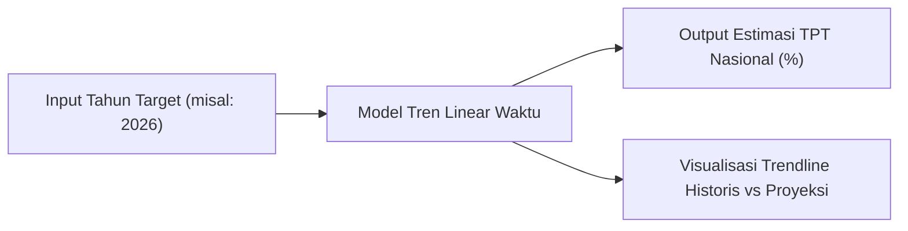
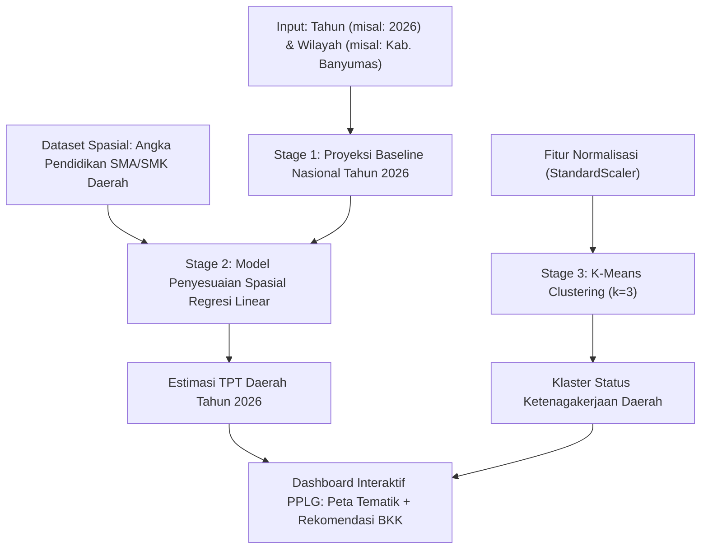

# Perbandingan Komparatif: Opsi 2 vs Opsi 3 (Proyek Machine Learning PSAJ Matematika)

**Proyek**: Penilaian Sumatif Akhir Jenjang (PSAJ) Matematika Terintegrasi Kejuruan PPLG  
**Institusi**: SMK Telkom Purwokerto  
**Dokumen Terkait**: [main.typ](file:///home/splev/Projects/psaj_mtk/main.typ), [Dataset X](file:///home/splev/Projects/psaj_mtk/experiments/datasets/Persentase%20penduduk%20usia%2025%20Tahun%20keatas%20dengan%20pendidikan%20SMA%20ke%20atas%20menurut%20jenis%20kelamin,%202025%20(Dataset%20X).csv), [Dataset Y](file:///home/splev/Projects/psaj_mtk/experiments/datasets/Tingkat%20Pengangguran%20Terbuka%20Menurut%20Provinsi,%202025%20(dataset%20Y).csv)

---

## 1. Ringkasan Eksekutif

Dalam pengembangan proyek Machine Learning untuk memprediksi Tingkat Pengangguran Terbuka (TPT), terdapat dua paradigma pemodelan utama jika ingin memasukkan unsur proyeksi tahun masa depan (*"pada tahun x"*):
* **Opsi 2 ("LaborCast")**: Berfokus murni pada **dimensi waktu** (*time-series forecasting*), yaitu meramalkan TPT rata-rata nasional untuk tahun-tahun mendatang (misal: 2026, 2027, 2030) berdasarkan tren historis.
* **Opsi 3 ("EduLabor Hybrid Engine")**: Mengintegrasikan **dimensi waktu dan dimensi wilayah spasial** (*spatio-temporal hybrid*), yaitu memproyeksikan TPT agregat nasional pada tahun $t$, lalu mendistribusikannya ke tingkat 38 provinsi dan 514 kabupaten/kota berdasarkan indikator partisipasi pendidikan menengah lokal.

---

## 2. Profil Mendalam Opsi 2: "LaborCast"

### A. Konsep Dasar
Opsi 2 menjawab secara literal perumusan masalah *"memperkirakan berapa tingkat pengangguran pada tahun x"*. Variabel bebas ($X$) adalah **urutan waktu/tahun ($t$)**, dan variabel terikat ($Y$) adalah **Tingkat Pengangguran Terbuka agregat**.

### B. Formulasi Matematis (Tren Linear Sakernas BPS 2020–2025)
Berdasarkan data historis TPT BPS pascapandemi (Agustus 2020 s.d. 2025):
* 2020: $7{,}07\%$
* 2021: $6{,}49\%$
* 2022: $5{,}86\%$
* 2023: $5{,}32\%$
* 2024: $4{,}91\%$
* 2025: $4{,}85\%$

Persamaan Tren Linear Kuadrat Terkecil (*Ordinary Least Squares*):
$$\hat{Y}_t = a + b \cdot t$$
$$\mathbf{\hat{Y}_t = 952{,}28 - 0{,}4680 \cdot t}$$

* **Koefisien Determinasi ($R^2$)**: $0{,}9576$ ($95{,}76\%$ variasi penurunan TPT dijelaskan oleh pergeseran tahun).
* **Signifikansi**: $p\text{-value} = 0{,}0007$ ($p < 0{,}01$, sangat signifikan).
* **Laju Penurunan Rata-rata**: $-0{,}468\%$ per tahun.

**Contoh Proyeksi Masa Depan**:
* Tahun 2026: $\hat{Y}_{2026} = 952{,}28 - 0{,}4680(2026) = \mathbf{4{,}11\%}$
* Tahun 2027: $\hat{Y}_{2027} = 952{,}28 - 0{,}4680(2027) = \mathbf{3{,}64\%}$

### C. Alur Kerja Sistem (Opsi 2)

### D. Kelebihan & Keterbatasan Opsi 2
* **Kelebihan**:
  1. Formulasi matematika sangat intuitif dan mudah dipahami dalam kurikulum statistika SMK.
  2. Implementasi antarmuka web (frontend & backend) sangat cepat dibuat.
* **Keterbatasan**:
  1. Tidak memanfaatkan dataset spasial provinsi dan kabupaten/kota yang sudah diunduh di repositori.
  2. Mengabaikan variasi antardaerah (angka TPT nasional tidak bisa menggambarkan realitas di Banyumas, DKI Jakarta, atau Papua).
  3. Siswa wajib menambahkan file CSV baru berupa data historis tahunan (2015–2025).

---

## 3. Profil Mendalam Opsi 3: "EduLabor Hybrid Engine"

### A. Konsep Dasar
Opsi 3 dirancang sebagai sistem kecerdasan buatan terpadu (*multi-stage inference engine*). Sistem ini menghubungkan pergerakan tren makro nasional dengan kondisi riil pendidikan di daerah.

### B. Formulasi Matematis & Arsitektur Dua Tingkat (*Two-Stage Engine*)

1. **Stage 1 (Macro Time-Series Forecast)**:
   Menghitung proyeksi baseline TPT nasional pada tahun target $t$:
   $$\bar{Y}_t = 952{,}28 - 0{,}4680 \cdot t$$

2. **Stage 2 (Micro Spatial Adjustment & Clustering)**:
   Menyesuaikan estimasi untuk masing-masing daerah ($i$) berdasarkan angka partisipasi pendidikan menengah ($X_i$) dan bobot deviasi historis terhadap rata-rata nasional:
   $$\hat{Y}_{i,t} = \bar{Y}_t + \beta \cdot (X_i - \bar{X}) + \epsilon_i$$
   Di mana:
   * $\beta = +0{,}0851$ (kemiringan regresi spasial pendidikan terhadap TPT).
   * $\bar{X} = 43{,}66\%$ (rata-rata nasional persentase pendidikan SMA ke atas).
   * Ditambah segmentasi wilayah otomatis menggunakan **K-Means Clustering** ($k = 3$ dengan `StandardScaler`) untuk membagi daerah ke dalam 3 status kerawanan penyerapan kerja.

### C. Alur Kerja Sistem (Opsi 3)

### D. Kelebihan & Keterbatasan Opsi 3
* **Kelebihan**:
  1. **Paling Komprehensif**: Menjawab pertanyaan *"kapan"* sekaligus *"di mana"*.
  2. **Memaksimalkan Seluruh Aset Data**: Menggunakan data Sakernas tahunan sekaligus 38 provinsi dan 514 kabupaten/kota yang ada di [Dataset X](file:///home/splev/Projects/psaj_mtk/experiments/datasets/Persentase%20penduduk%20usia%2025%20Tahun%20keatas%20dengan%20pendidikan%20SMA%20ke%20atas%20menurut%20jenis%20kelamin,%202025%20(Dataset%20X).csv).
  3. **Nilai Praktis Tertinggi untuk Mitra**: BKK SMK Telkom Purwokerto dan Disnaker Banyumas mendapatkan prediksi spesifik untuk wilayah Banyumas dan sekitarnya.
* **Keterbatasan**:
  1. Memerlukan penulisan logika backend yang lebih cermat (menggabungkan modul deret waktu dan regresi spasial).
  2. Dokumentasi bab pembahasan di [main.typ](file:///home/splev/Projects/psaj_mtk/main.typ) menjadi lebih panjang karena mencakup dua jenis model evaluasi.

---

## 4. Matriks Perbandingan Komparatif

| Dimensi Evaluasi | Opsi 2 ("LaborCast") | Opsi 3 ("EduLabor Hybrid Engine") |
| :--- | :--- | :--- |
| **Fokus Pertanyaan** | *"Berapa TPT nasional pada tahun $t$?"* | *"Berapa TPT di wilayah $i$ pada tahun $t$?"* |
| **Dimensi Data** | 1 Dimensi (Waktu / Deret Berkala) | 2 Dimensi (Waktu + Spasial Geografis) |
| **Dataset yang Dipakai** | Data Tren Sakernas 2020–2025 (data baru) | Data Tren Sakernas + [Dataset X](file:///home/splev/Projects/psaj_mtk/experiments/datasets/Persentase%20penduduk%20usia%2025%20Tahun%20keatas%20dengan%20pendidikan%20SMA%20ke%20atas%20menurut%20jenis%20kelamin,%202025%20(Dataset%20X).csv) & [Dataset Y](file:///home/splev/Projects/psaj_mtk/experiments/datasets/Tingkat%20Pengangguran%20Terbuka%20Menurut%20Provinsi,%202025%20(dataset%20Y).csv) di repositori |
| **Cakupan Wilayah** | Hanya agregat nasional (1 baris output) | 38 Provinsi & 514 Kabupaten/Kota (termasuk Kab. Banyumas) |
| **Algoritma ML / Matematika** | Regresi Tren Linear Sederhana | Regresi Tren Linear + Regresi Spasial OLS + K-Means Clustering terstandarisasi |
| **Kesesuaian Rubrik Bab IV** | Cukup (hanya memenuhi regresi waktu) | **Sangat Sempurna** (memenuhi distribusi Sturgess, korelasi Pearson, regresi, LOOCV, dan K-Means) |
| **Relevansi Kejuruan PPLG** | Aplikasi kalkulator linear sederhana | Sistem dashboard analitik modern dengan visualisasi peta interaktif (*Choropleth*) |
| **Kompleksitas Pengembangan** | Rendah (dapat selesai dalam 1 hari) | Menengah (proyek berkualitas portofolio kejuruan) |
| **Kesesuaian Mitra (BKK/Disnaker)** | Rendah (informasi makro terlalu umum) | **Sangat Tinggi** (memberi simulasi penempatan lulusan SMK per daerah) |

---

## 5. Panduan Pengambilan Keputusan

1. **Pilih Opsi 2 jika**:
   * Tim memiliki tenggat waktu pengumpulan yang sangat mendesak (kurang dari 2 hari).
   * Tim hanya ingin fokus pada pemenuhan tugas regresi linear matematika standar tanpa perlu membangun fitur pemetaan daerah.
2. **Pilih Opsi 3 jika**:
   * Tim menargetkan **nilai maksimal (A+)** pada PSAJ Matematika terintegrasi PPLG.
   * Tim ingin membangun produk perangkat lunak yang layak dipamerkan sebagai portofolio kelulusan SMK Telkom Purwokerto.
   * Tim ingin memanfaatkan data 514 Kabupaten/Kota yang sudah berhasil diunduh ke dalam repositori.

---

## 6. Template Isian Cepat untuk Laporan Typst ([main.typ](file:///home/splev/Projects/psaj_mtk/main.typ))

Jika tim memutuskan opsi yang dipilih, judul dan fokus masalah dapat langsung disesuaikan pada baris 24 dan 322 di berkas [main.typ](file:///home/splev/Projects/psaj_mtk/main.typ):

* **Untuk Opsi 2**:
  > *"Rancang Bangun Sistem Peramalan Tingkat Pengangguran Terbuka Nasional Berbasis Regresi Tren Waktu"*
* **Untuk Opsi 3**:
  > *"Rancang Bangun Sistem Prediksi Spasio-Temporal Tingkat Pengangguran Terbuka Berbasis Regresi Linear dan K-Means Clustering Terintegrasi Web"*
